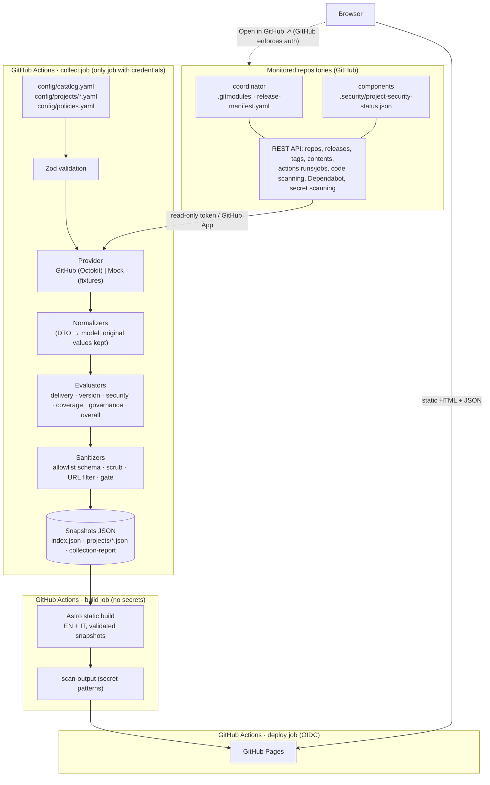

# Architecture

> 🇮🇹 [Versione italiana](it/architecture.md)

## Context

The organisation builds software projects that span many GitHub repositories: a
coordinator ("umbrella") repository with Git submodules, plus application, frontend,
backend, worker, Helm and infrastructure repositories. These share reusable workflows,
composite actions and container images, and are deployed to DEV, TEST, UAT and PROD. GitHub
shows data per repository, per workflow or per organisation. It has no view built around
the **logical project**.

Engineering Project Hub fills that gap with a read-only, static portal. It stays
GitHub-native: code, configuration, data collection (Actions) and hosting (Pages) all live
on GitHub, with no database and no permanent server.

## Overview

## Components

| Component        | Path                         | Responsibility                                                                                                                                                                |
| ---------------- | ---------------------------- | ----------------------------------------------------------------------------------------------------------------------------------------------------------------------------- |
| Model / contract | `shared/model/`              | Zod schemas and TypeScript types for the catalog, policies, external contracts and snapshots. This is the only code shared by the collector and the site.                     |
| Config loader    | `collector/src/config/`      | Parses YAML and validates it with Zod. Errors are reported with exact paths.                                                                                                  |
| Providers        | `collector/src/providers/`   | `SourceProvider` interface. `GitHubProvider` (Octokit with throttling and retry) and `MockProvider` (fixtures). They return `ProviderResult<T>`: data, or a classified error. |
| Collectors       | `collector/src/collectors/`  | Orchestrate provider calls per project, with a concurrency limit and a cache shared across projects.                                                                          |
| Normalizers      | `collector/src/normalizers/` | Map DTOs onto the normalised model: severities, statuses, categories, workflow states, versions, submodules, controls.                                                        |
| Evaluators       | `collector/src/evaluators/`  | Pure health functions, driven by `policies.yaml`. Each result carries reasons.                                                                                                |
| Sanitizers       | `collector/src/sanitizers/`  | Text scrubbing, URL allowlist, final publication gate.                                                                                                                        |
| Writers          | `collector/src/writers/`     | Strict schema validation, gate, then writing the snapshots and the collection report.                                                                                         |
| Site             | `src/`                       | Astro pages (`[...lang]` for EN `/` and IT `/it/`), components, i18n, CSS design tokens, small client scripts (filters, relative times, theme).                               |
| Scripts          | `scripts/`                   | Config and snapshot validation, output secret scan, golden and JSON Schema generation.                                                                                        |

## Data flow

1. **Load and validate** the catalog (`config/catalog.yaml`, `config/projects/*.yaml`) and
   `config/policies.yaml`. Invalid config
   stops the run.
2. **Resolve credentials** in this order: GitHub App, `GH_READ_TOKEN`, `GITHUB_TOKEN`,
   then mock only when explicitly selected.
3. **Collect per repository**: metadata, then branch head, latest release (falling back to
   the latest tag), security status file, code scanning alerts and latest analysis,
   Dependabot alerts, and secret scanning alerts (`hide_secret=true`), the
   `hub-quality-summary` artifact (newest default-branch, same-repository run; zip capped
   at 64 KB) and the GitHub Code Quality findings. **Repository controls** add, per unique
   repository (a monorepo is read once): the branch rules of the default branch, the files of
   `.github/workflows` (at most 30 by default, parsed in memory into validated `uses:`
   references), the latest OpenSSF Scorecard analysis and, only when enabled, classic branch
   protection. The latest release or tag of every referenced reusable-workflow repository is
   resolved once per run (at most 50 repositories). When the metadata call fails,
   dependent calls are skipped and inherit its classified error.
4. **Collect per project**: the release manifest and `.gitmodules` from the coordinator,
   the submodule SHAs, and the tracked workflow runs (the last 20 on the default branch),
   plus the failed job and step names of the last failed run. Each submodule linked to a
   component is resolved: the component's tags are matched against the pinned SHA, and if
   no tag matches, the SHA is compared with the latest release (ahead / behind / diverged).
5. **Normalise**: provider values become the model's enums. `originalSeverity` and
   `originalStatus` are kept.
6. **Evaluate**: delivery, version, security risk, coverage (controls), governance (with
   the six repository checks, informative unless enforced), quality (test coverage),
   freshness and overall.
7. **Sanitise and validate**: free text is scrubbed and links are filtered. Every document
   is parsed with the strict schemas (allowlist), then the serialised JSON goes through the
   credential gate. Any failure stops the run before anything is written.
8. **Append and diff**: the previous history is loaded (see below), the current run is
   appended with retention, and the diff against the previous baseline is computed.
9. **Write** `public/data/index.json`, `projects/<id>.json`, `history.json`,
   `changes.json`, `collection-report.json` and `collection-report.md`.
10. **Build** the site. The pages load and re-validate the snapshots at build time, and
    write the three CSV exports. An unsupported `schemaVersion` renders a controlled error
    page. A missing or invalid `history.json` or `changes.json` never fails the build.
11. **Scan the output** (`dist/`, `public/data/`) for credential patterns and for the
    values of credentials in the environment, then publish.

**History, in CI:** restore → collect → append → diff → publish. Before step 1 the
`collect` job restores the hub's own newest `hub-history` artifact into `.history-restore/`
(own repository, default branch, not a fork; see [Operations](operations.md#history-between-runs)).
The collector treats it as untrusted input, re-validates and rewrites it, and the job
uploads the new `history.json` as the next `hub-history` artifact (90 days). A mock run
never restores: it starts from `fixtures/history/history.json`.

## Trust boundaries

| Boundary                               | Controls                                                                                                                                                                                                                                                                                                                                                                             |
| -------------------------------------- | ------------------------------------------------------------------------------------------------------------------------------------------------------------------------------------------------------------------------------------------------------------------------------------------------------------------------------------------------------------------------------------ |
| GitHub API → collector                 | Read-only credentials. Only allow-listed DTO fields are mapped. Raw payloads never leave the provider.                                                                                                                                                                                                                                                                               |
| Collector → snapshots                  | Strict Zod schemas (unknown keys rejected), text scrubbing, URL host allowlist, credential gate.                                                                                                                                                                                                                                                                                     |
| CI artifact → collector                | Only the `hub-quality-summary` artifact of a default-branch run from the same repository is read: zip ≤ 64 KB, one file, strict schema, `repository` must match. Failure means `invalid` and nothing is published.                                                                                                                                                                   |
| Actions artifact → collector (history) | Only the hub's own `hub-history` artifact of a default-branch run of the deploy or collect workflow, not from a fork, not the current run, at most 5 MiB. The collector then parses it strictly (8 MiB cap), re-sanitises links and text, and rewrites it. Failure starts history fresh, never fails the run.                                                                        |
| Workflow files → collector             | Untrusted input. Read through the Contents API, bounded (262 144 bytes per file, 200 references per file, 1 000 per repository, 30 files by default), parsed in memory with an alias limit, reduced to validated `uses:` references. Workflow text, step names, `run:`, `with:` and `env:` never leave the parser and are never published; `target` is rebuilt from validated parts. |
| Collect job → build job                | Only the sanitised `snapshots` artifact crosses. The build job has no secrets.                                                                                                                                                                                                                                                                                                       |
| Build → GitHub Pages                   | Output scan. Deploy uses OIDC (`pages: write`, `id-token: write`) only in the deploy job.                                                                                                                                                                                                                                                                                            |
| Pages → browser                        | Static files only. CSP `default-src 'self'` with no inline scripts. No GitHub API calls. No tokens in storage.                                                                                                                                                                                                                                                                       |
| Browser → GitHub (links)               | GitHub applies its own authorisation. The portal never proxies or bypasses it.                                                                                                                                                                                                                                                                                                       |

## Snapshot model

`index.json` (`PortfolioIndex`) has these fields:

- `schemaVersion` and `generatedAt`
- `run`: data source, authentication mode, collector version, timings, per-capability
  availability, inaccessible sources, repository counts, and the policy excerpt (stale
  threshold, audience)
- `projects[]`: a `ProjectSummary` for each project. It holds every dimension status,
  coverage summary, open counts (`null` = unknown), the secret scanning state, failed
  critical workflows, error counts, unresolved submodules and the project `score`.

`history.json` (`kind: hub-history`) and `changes.json` (`kind: hub-changes`) are versioned
separately (history `1.1`, changes `1.0`) from the snapshot (`1.5`), so history survives a snapshot schema
bump and an existing `public/data` stays readable. `history.json` has one compact point per
project and collection plus the baseline of the latest run; `changes.json` is the diff
the site renders. Unknown is never 0: a null score is a gap.

`projects/<id>.json` (`ProjectSnapshot`) has these fields:

- `project`, `coordinator` (repository, version and source, latest release, manifest
  status, submodules), `components[]`, `environments[]` and `workflows[]`
- `securityFindings[]` (`SecurityFinding`) and `securityControls[]` (repository ×
  control state)
- `deliveryHealth`, `versionHealth`, `securityHealth` (with counts and breakdowns),
  `securityCoverage`, `governanceHealth`, `repositoryControls`, `qualityHealth` and
  `overallHealth`
- `repositoryControls`: `{ enabled, collectedAt, passed, failed, unknown, notApplicable, ratio,
perCheck[], repositories[] }`. Each repository has its six check states, the workflow
  reference counts and (non-public repositories: withheld) the unpinned references, the
  reusable workflows, a branch rules summary and a Scorecard summary. Unknown is never 0.
- `qualityHealth`: `{ status, reasons, percentage, linesCovered, linesValid, measured,
applicable, notVisible, stale, collectedAt }`, `perComponent[]` (state, percentage,
  lines, commit SHA, report date, tool, run link) and `findings` (Code Quality counts by
  category and severity, with a state). Findings exist only at project level.
- `score`: `{ value, measured, required }`, computed by the collector (`value` is `null`
  when data is insufficient; see [Configuration](configuration.md#project-score))
- `dataFreshness` and `collectionErrors[]`

Normalised enums:

| Enum             | Values                                                                                                                                   |
| ---------------- | ---------------------------------------------------------------------------------------------------------------------------------------- |
| Health status    | `green`, `amber`, `red`, `grey`                                                                                                          |
| Severity         | `critical`, `high`, `medium`, `low`, `informational`, `unknown`                                                                          |
| Finding status   | `open`, `fixed`, `dismissed`, `accepted-risk`, `false-positive`, `unknown`                                                               |
| Finding category | `code`, `dependency`, `secret`, `container`, `iac`, `dast`, `supply-chain`, `configuration`                                              |
| Control state    | `enabled`, `not-configured`, `configured-not-run`, `not-authorised`, `failed`, `stale`, `unknown`, `collection-failed`, `not-applicable` |
| Error class      | `not-found`, `not-authorised`, `not-configured`, `rate-limited`, `invalid-data`, `error`                                                 |

Generated JSON Schemas are in `config/schema/`. The site supports the snapshot versions
listed in `SUPPORTED_SNAPSHOT_SCHEMA_VERSIONS` (currently `1.5`).

## Health rules (MVP policies)

These are **policies of this MVP**, configurable in `config/policies.yaml`. They are not
universal risk ratings.

- **Delivery**:
  - red when the last completed run of a critical workflow failed or was cancelled
  - amber when a critical workflow is missing, has never run, is stale, has been queued
    longer than the threshold, or only some of its data is available
  - green when every critical workflow's last run succeeded
  - grey when there is no data
- **Version**:
  - red when the manifest references an unknown component, or a submodule cannot be
    resolved
  - amber when the current version (per `versionSource`) differs from the latest release,
    the coordinator pins an untagged SHA, the manifest disagrees with the pinned tag, an
    environment is behind or mismatched, there is an unmapped submodule, or the manifest is
    missing or invalid
  - green when everything is aligned
  - grey when no version can be determined
- **Security risk**:
  - red when there is an open alert at the `redOnSeverities` level (critical by default),
    an open secret alert, or a required control has failed
  - amber when there are high, medium or low alerts, a required scan is stale, coverage is
    incomplete, or counts are partial
  - green only when there are zero open alerts, full coverage and complete data
  - grey when nothing is readable. A known critical is still shown as red.
- **Coverage**: the percentage is computed on **required** controls only, using the worst
  state across the project's repositories. It is never used to hide alerts.
  - green when all required controls are available
  - grey with no percentage when no required control is readable
  - amber otherwise
- **Quality** (test coverage; not to be confused with Coverage above, which the UI calls
  "Controls coverage"):
  - project coverage is the line-weighted sum over the applicable repositories whose
    report is readable or stale, each repository counted once; components without a
    visible report never count, and never count as 0%
  - green at or above `quality.greenThresholdPercent` (80), amber at or above
    `quality.amberThresholdPercent` (60), red below
  - a stale report, or a not-visible applicable component when `missingReportIsAmber`
    is true, caps green at amber; a red stays red
  - grey when nothing applies or nothing is visible
  - not critical (a red counts as amber overall) and optional by default
    (`overall.optionalDimensions`): ignored when grey, so it neither turns the project grey
    nor lowers the score
  - Code Quality findings are shown but never change the status
- **Governance**:
  - amber for a missing standard workflow, an archived repository, a missing or invalid
    status file (when non-native controls are required), or a default branch mismatch
  - grey when no repository is accessible
- **Overall**:
  - red when a critical dimension (delivery, version or security by default) is red
  - amber when any dimension is amber, or a non-critical dimension is red
  - green only when all required dimensions are green; a measured optional dimension
    (Quality by default) counts like a required non-critical one, a grey one is ignored
  - grey otherwise, or amber if `greyRequiredDimension: amber`

## Error handling

- Every provider call returns `ProviderResult`. Exceptions are converted to classified
  errors, so one repository can never abort the others.
- **403 is not "no alerts"**: it is `not-authorised`, and the control state becomes
  Not authorised.
- **404 is not "disabled"**. A 404 or 403 whose message says the feature is disabled
  (or "no analysis found") becomes `not-configured`. Any other 404 on a security endpoint
  stays `unknown`. A 404 on a workflow file means the workflow is **missing**, which counts
  against governance. A 404 on a release means there is no release, so the latest tag is
  used.
- Rate limits are retried once when the wait is ≤ 60 s. After that the call is
  `rate-limited`.
- The run fails only for structural reasons: invalid config, missing or partial
  credentials, a snapshot schema violation, or the sanitisation gate.

## Architectural decisions

- [ADR 0001: Static-first, GitHub-native architecture](architecture/adr/0001-static-first-github-native.md)
- [ADR 0002: Snapshot contract and provider abstraction](architecture/adr/0002-snapshot-contract-and-provider-abstraction.md)
- [ADR 0003: Reusable CI building blocks and a collect/build/deploy split](architecture/adr/0003-ci-building-blocks-and-collect-deploy-split.md)
- [ADR 0004: Configuration store, discovery and the path to a backend](architecture/adr/0004-configuration-store-and-discovery.md)
- [ADR 0005: Test coverage from a CI summary artifact, not from Sonar or GitHub UI](architecture/adr/0005-test-coverage-from-ci-summary-artifact.md)
- [ADR 0006: History persisted through the hub's own Actions artifacts](architecture/adr/0006-history-persisted-through-own-actions-artifacts.md)
- [ADR 0007: Repository controls from workflow files and the rules API, informative by default](architecture/adr/0007-repository-controls-informative-by-default.md)

Further decisions:

- Astro SSG renders everything at build time. Client JavaScript only handles filters,
  relative times and the theme toggle, and it is served as external modules
  (`assetsInlineLimit: 0`) so the CSP can forbid inline scripts.
- i18n uses `[...lang]` routes: EN at `/`, IT at `/it/`. The typed dictionaries must have
  identical keys, which is enforced by `Dict` and tested. Snapshots stay language-neutral:
  reasons are codes plus parameters.
- Native CSS design tokens ("Warm Graphite", light and dark themes, WCAG AA contrast checked
  by a unit test), described in [`DESIGN.md`](../DESIGN.md). The UI was validated with
  hi-fi mockups before implementation. Fonts are self-hosted IBM Plex Sans and IBM Plex
  Mono (OFL) via `@fontsource`.
- TypeScript is pinned to 6.0 for tooling compatibility (typescript-eslint,
  `@astrojs/check`).
