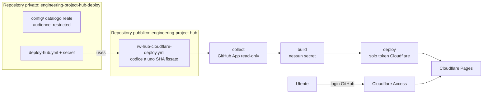

# Hosting protetto (Cloudflare Pages + Access)

> 🇬🇧 [English version](../protected-hosting.md)

Il sito pubblico su GitHub Pages è una **demo con dati sintetici**. Per pubblicare **dati
reali** (anche di repository privati) il portale va servito dietro un login. Questa guida
usa Cloudflare Pages con Cloudflare Access (Zero Trust, gratuito fino a 50 utenti) e login
GitHub.

## Perché non GitHub Pages

| Esigenza                                 | GitHub Pages (Free / Pro / Team)                | Cloudflare Pages + Access                             |
| ---------------------------------------- | ----------------------------------------------- | ----------------------------------------------------- |
| Login prima di qualsiasi pagina o JSON   | No (Pages private: solo Enterprise Cloud)       | Sì, applicato sull'edge prima di servire la richiesta |
| Header HTTP di sicurezza (clickjacking…) | No (solo CSP `<meta>`, senza `frame-ancestors`) | Sì, `public/_headers`                                 |
| Log e artifact delle esecuzioni privati  | Solo se il repository è privato                 | Sì, con un repository di deploy privato (sotto)       |

## Architettura



- Il codice resta pubblico (CI, CodeQL, attestazioni, demo mock invariati).
- Il **repository di deploy privato** contiene il catalogo reale, i secret e il workflow
  che chiama `rw-hub-cloudflare-deploy.yml`. L'esecuzione avviene nel chiamante, quindi
  log, riepiloghi e artifact (snapshot con nomi reali) sono privati.
- Gira solo codice dell'hub **rilasciato**: un primo job senza permessi rifiuta qualsiasi
  `hub-ref` che non sia lo SHA completo del commit di un tag di release `v*` (tag protetti
  dal ruleset `release-tags`), quindi un branch o un commit arbitrario non gira mai accanto
  alle credenziali.
- I job mantengono i confini di fiducia di `deploy-pages.yml`: credenziali GitHub solo in
  `collect`, nessun secret in `build`, solo il token Cloudflare in `deploy` (che non esegue
  codice dell'hub).

## Configurazione

### 1. Cloudflare

1. Aggiungi il dominio a Cloudflare (DNS completo: Access protegge solo gli hostname
   proxati da Cloudflare). Scegli l'hostname del portale, es. `hub.<tuo-dominio>`.
2. Crea il progetto Pages (Direct Upload) con branch di produzione `main`:
   `npx wrangler pages project create engineering-project-hub --production-branch main`
   (oppure Workers & Pages → Create → Pages → Upload assets).
3. Progetto Pages → **Custom domains** → aggiungi `hub.<tuo-dominio>`.
4. Crea un **API token** (My Profile → API Tokens → Custom token): permesso
   **Account → Cloudflare Pages → Edit**, limitato al tuo account, con scadenza.
   Annota l'**Account ID** (panoramica Workers & Pages).

### 2. Cloudflare Access con login GitHub

1. Zero Trust → scegli un team name (`<team>.cloudflareaccess.com`), piano Free.
2. Su GitHub crea una **OAuth App** (Settings → Developer settings → OAuth Apps):
   - Homepage URL: `https://<team>.cloudflareaccess.com`
   - Authorization callback URL: `https://<team>.cloudflareaccess.com/cdn-cgi/access/callback`
3. Zero Trust → Settings → Authentication → **Login methods** → aggiungi **GitHub** con
   client ID e secret della OAuth App. Rimuovi "One-time PIN" se non serve.
4. Zero Trust → Access → Applications → **Self-hosted**, con **tutti** questi hostname:
   - `hub.<tuo-dominio>`
   - `engineering-project-hub.pages.dev`
   - `*.engineering-project-hub.pages.dev` (URL di anteprima e dei singoli deploy)

   > ⚠️ Se manca un hostname `pages.dev`, lo stesso contenuto è raggiungibile senza login.

5. Policy **Allow**, Include: **GitHub organization** `<tua-org>` (o email specifiche).
   Durata sessione: 24 h o meno. Identity provider: solo GitHub.

### 3. GitHub App (collector in sola lettura)

Segui [security.md → Modello di autorizzazione](security.md#modello-di-autorizzazione):
permessi in sola lettura, installata **solo** sui repository da monitorare (anche privati).

### 4. Repository di deploy privato

1. Crea un repository **privato**, es. `<owner>/engineering-project-hub-deploy`.
2. Aggiungi `config/` (stessa struttura di questo repository: `catalog.yaml`, `projects/`,
   `policies.yaml`). In `policies.yaml` imposta `publication.audience: restricted`; in
   `catalog.yaml` la discovery può usare `includePrivate: true`. Mantieni il nome
   `config` (i link dell'editor del catalogo puntano a `config/projects/`).
3. Copia [`examples/protected-deploy/.github/workflows/deploy-hub.yml`](../../examples/protected-deploy/.github/workflows/deploy-hub.yml)
   e sostituisci `HUB_SHA` con lo SHA del commit di un tag di release dell'hub.
4. Secret: `GH_APP_ID`, `GH_APP_PRIVATE_KEY`, `GH_APP_INSTALLATION_ID`,
   `CLOUDFLARE_API_TOKEN`. Variabili: `CLOUDFLARE_ACCOUNT_ID`, `CLOUDFLARE_PAGES_PROJECT`,
   `HUB_SITE_URL` (`https://hub.<tuo-dominio>`).
5. Settings → Environments → `production`: deployment branch **solo main**; facoltativo:
   sposta `CLOUDFLARE_API_TOKEN` in questo environment così solo il job di deploy lo legge.
6. Settings → Actions → General: `GITHUB_TOKEN` di default in sola lettura, nessuna
   approvazione di PR.
7. Avvia il workflow (Actions → Deploy → Run workflow).

L'editor del catalogo del sito protetto apre le pagine GitHub del repository di **deploy**
(`CATALOG_REPOSITORY`, impostato automaticamente al repository chiamante).

## Verifica

```bash
# Senza login: deve reindirizzare a Cloudflare Access (302 → <team>.cloudflareaccess.com)
curl -sI https://hub.<tuo-dominio>/ | grep -iE '^(HTTP|location)'
curl -sI https://engineering-project-hub.pages.dev/ | grep -iE '^(HTTP|location)'
curl -sI https://engineering-project-hub.pages.dev/data/index.json | grep -iE '^(HTTP|location)'
```

Dopo il login, gli strumenti di sviluppo del browser mostrano `content-security-policy` con
`frame-ancestors 'none'`, `x-frame-options: DENY`, `strict-transport-security` e
`cache-control: no-store` su `/data/*`.

## Aggiornare l'hub

Fissa una nuova release: aggiorna entrambe le occorrenze di `HUB_SHA` allo SHA del commit
del nuovo tag. Leggi prima il CHANGELOG; il repository di deploy non segue mai `main` in
automatico.

## Limiti

- Chiunque sia ammesso dalla policy Access vede tutti i progetti (nessuna autorizzazione
  per progetto). Mantieni la policy stretta quanto richiede il progetto più sensibile.
- L'autorizzazione per utente e per repository richiede un backend (ADR 0004).
- Il token Cloudflare può sostituire il contenuto del sito: limitalo a Pages, imposta una
  scadenza e ruotalo come le altre credenziali.
