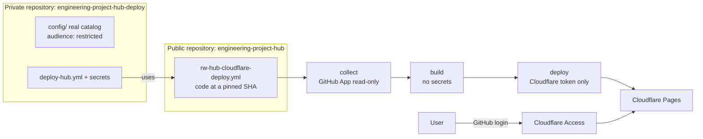

# Protected hosting (Cloudflare Pages + Access)

> 🇮🇹 [Versione italiana](it/protected-hosting.md)

The public GitHub Pages site is a **demo with synthetic data**. To publish **real data**
(including private repositories), serve the portal behind a login. This guide uses
Cloudflare Pages with Cloudflare Access (Zero Trust, free up to 50 users) and GitHub login.

## Why not GitHub Pages

| Need                                  | GitHub Pages (Free / Pro / Team)             | Cloudflare Pages + Access                              |
| ------------------------------------- | -------------------------------------------- | ------------------------------------------------------ |
| Login before any page or JSON file    | No (private Pages: Enterprise Cloud)         | Yes, enforced at the edge before the request is served |
| HTTP security headers (clickjacking…) | No (`<meta>` CSP only, no `frame-ancestors`) | Yes, `public/_headers`                                 |
| Private run logs and artifacts        | Only if the repository is private            | Yes, with a private deploy repository (below)          |

## Architecture



- The code stays public (CI, CodeQL, attestations, mock demo unchanged).
- The **private deploy repository** holds the real catalog, the secrets and the workflow
  that calls `rw-hub-cloudflare-deploy.yml`. The run happens in the caller, so logs,
  job summaries and artifacts (snapshots with real names) are private.
- Jobs keep the trust boundaries of `deploy-pages.yml`: GitHub credentials only in
  `collect`, no secrets in `build`, only the Cloudflare token in `deploy` (which runs no
  hub code).

## Setup

### 1. Cloudflare

1. Add your domain to Cloudflare (full DNS setup: Access only protects hostnames that
   Cloudflare proxies). Choose the portal hostname, e.g. `hub.<your-domain>`.
2. Create the Pages project (Direct Upload) with production branch `main`:
   `npx wrangler pages project create engineering-project-hub --production-branch main`
   (or Workers & Pages → Create → Pages → Upload assets).
3. Pages project → **Custom domains** → add `hub.<your-domain>`.
4. Create an **API token** (My Profile → API Tokens → Custom token): permission
   **Account → Cloudflare Pages → Edit**, limited to your account, with an expiry date.
   Note the **Account ID** (Workers & Pages overview).

### 2. Cloudflare Access with GitHub login

1. Zero Trust → choose a team name (`<team>.cloudflareaccess.com`), Free plan.
2. On GitHub, create an **OAuth App** (Settings → Developer settings → OAuth Apps):
   - Homepage URL: `https://<team>.cloudflareaccess.com`
   - Authorization callback URL: `https://<team>.cloudflareaccess.com/cdn-cgi/access/callback`
3. Zero Trust → Settings → Authentication → **Login methods** → add **GitHub** with the
   OAuth App client ID and secret. Remove "One-time PIN" if you do not want it.
4. Zero Trust → Access → Applications → **Self-hosted**, with **all** these hostnames:
   - `hub.<your-domain>`
   - `engineering-project-hub.pages.dev`
   - `*.engineering-project-hub.pages.dev` (preview and per-deployment URLs)

   > ⚠️ If a `pages.dev` hostname is missing, the same content is reachable without login.

5. Policy **Allow**, Include: **GitHub organization** `<your-org>` (or specific emails).
   Session duration: 24 h or less. Identity providers: GitHub only.

### 3. GitHub App (read-only collector)

Follow [security.md → Authorisation model](security.md#authorisation-model): read-only
permissions, installed **only** on the repositories to monitor (private ones included).

### 4. Private deploy repository

1. Create a **private** repository, e.g. `<owner>/engineering-project-hub-deploy`.
2. Add `config/` (same layout as this repository: `catalog.yaml`, `projects/`,
   `policies.yaml`). In `policies.yaml` set `publication.audience: restricted`; in
   `catalog.yaml` discovery may set `includePrivate: true`. Keep the directory name
   `config` (the catalog editor links point to `config/projects/`).
3. Copy [`examples/protected-deploy/.github/workflows/deploy-hub.yml`](../examples/protected-deploy/.github/workflows/deploy-hub.yml)
   and replace `HUB_SHA` with the commit SHA of a hub release tag.
4. Secrets: `GH_APP_ID`, `GH_APP_PRIVATE_KEY`, `GH_APP_INSTALLATION_ID`,
   `CLOUDFLARE_API_TOKEN`. Variables: `CLOUDFLARE_ACCOUNT_ID`, `CLOUDFLARE_PAGES_PROJECT`,
   `HUB_SITE_URL` (`https://hub.<your-domain>`).
5. Settings → Environments → `production`: deployment branches **main only**; optionally
   move `CLOUDFLARE_API_TOKEN` into this environment so only the deploy job can read it.
6. Settings → Actions → General: default `GITHUB_TOKEN` read-only, no PR approval.
7. Run the workflow (Actions → Deploy → Run workflow).

The catalog editor of the protected site opens GitHub pages in the **deploy** repository
(`CATALOG_REPOSITORY`, set automatically to the calling repository).

## Verify

```bash
# No login: must redirect to Cloudflare Access (302 → <team>.cloudflareaccess.com)
curl -sI https://hub.<your-domain>/ | grep -iE '^(HTTP|location)'
curl -sI https://engineering-project-hub.pages.dev/ | grep -iE '^(HTTP|location)'
curl -sI https://engineering-project-hub.pages.dev/data/index.json | grep -iE '^(HTTP|location)'
```

After logging in, the browser dev tools show `content-security-policy` with
`frame-ancestors 'none'`, `x-frame-options: DENY`, `strict-transport-security` and
`cache-control: no-store` on `/data/*`.

## Upgrading the hub

Pin a new release: update both `HUB_SHA` occurrences to the new tag's commit SHA. Read
the CHANGELOG first; the deploy repository never follows `main` automatically.

## Limits

- Everyone allowed by the Access policy sees every project (no per-project
  authorisation). Keep the policy as narrow as the most sensitive project requires.
- Per-user, per-repository authorisation needs a backend (ADR 0004).
- The Cloudflare token can replace the site content: scope it to Pages, set an expiry,
  rotate it like the other credentials.
